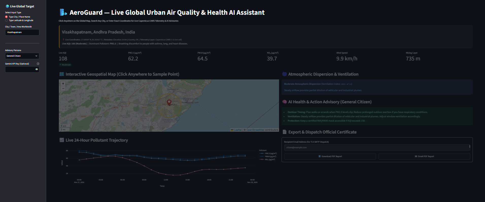
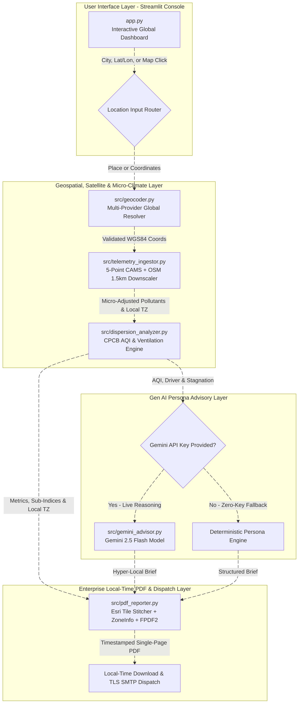

# 🌬️ AeroGuard — Global Urban Air Quality & Health AI Assistant

A cloud-native geospatial intelligence console for real-time global air quality monitoring, multi-cell atmospheric dispersion modeling, persona-driven Gemini AI health advisories, and automated enterprise PDF compliance reporting with stitched satellite map tiles and local timezone stamping.

> **Hack2Skill Submission Note:** Powered by **Google Gemini (`gemini-2.5-flash`)** via the `google-genai` SDK for persona-tailored urban air quality and health intelligence, combined with Copernicus CAMS satellite telemetry and OpenStreetMap micro-climate downscaling.

## About

AeroGuard provides a zero-API-cost, worldwide air quality intelligence pipeline that resolves any typed city, exact latitude/longitude, or interactive map click into live Copernicus CAMS satellite telemetry, 5-point bilinear spatial interpolation with OpenStreetMap 1.5 km micro-environment land-use downscaling, Indian CPCB National AQI sub-indices, boundary-layer ventilation physics, and executive PDF certificates stamped in the target location's local timezone (e.g., IST for India).

Built and maintained by [@SRINIVASTA](https://github.com/SRINIVASTA), this repository hosts a click-anywhere Folium geospatial interface, a multi-provider global geocoder, a hybrid satellite + OSM micro-climate ingestor, a CPCB linear sub-index & dispersion engine, a Gemini 2.5 Flash persona advisor (with deterministic fallback), and an FPDF2 stitched-map certificate builder.



## Modules in this repo

| Module | Description |
| :--- | :--- |
| `src/geocoder.py` | Multi-provider global location & coordinate resolver (Open-Meteo Geocoding, BigDataCloud, and OpenStreetMap Nominatim) with offshore/marine sector detection. |
| `src/telemetry_ingestor.py` | Zero-API-key Copernicus CAMS & ECMWF/GFS satellite telemetry ingestor featuring 5-point bilinear spatial interpolation, OpenStreetMap 1.5 km land-use micro-downscaling, and automatic local IANA timezone resolution. |
| `src/dispersion_analyzer.py` | Indian CPCB National AQI linear sub-index calculator, dominant pollutant identifier, and atmospheric ventilation/stagnation risk analyzer. |
| `src/gemini_advisor.py` | Gen AI health & operational advisory engine powered by `gemini-2.5-flash` (with automatic offline deterministic fallback) tailored across four citizen and municipal personas. |
| `src/pdf_reporter.py` | Single-page enterprise FPDF2 certificate generator that dynamically stitches Esri World Street Map tiles (`Pillow`), draws a red target pin, stamps local country/IST timestamps, and compiles CPCB telemetry tables. |
| `src/alert_dispatcher.py` | Encrypted TLS SMTP (`smtp.gmail.com`) report dispatcher for automated local-timestamped PDF certificate delivery. |

### Architecture & Workflow



### Key Capabilities

* **Click-Anywhere Global Telemetry & Micro-Downscaling:** Click any street, industrial belt, or coastline on the interactive Folium map—or search by city name or exact coordinates—to sample 5-point bilinear Copernicus CAMS air quality refined with 1.5 km OpenStreetMap industrial, arterial highway, and coastal/green dispersion factors.
* **CPCB Standards & Dispersion Physics:** Computes official CPCB linear sub-indices (`PM2.5`, `PM10`, `NO₂`, `O₃`) alongside atmospheric ventilation indices (`Wind Speed × Mixing Layer Height`) to detect pollutant stagnation traps.
* **Persona-Tailored AI & Local-Time Stitched-Map PDFs:** Generates actionable guidance for *General Citizens*, *Sensitive Groups*, *Outdoor Workers*, and *Municipal Planners*, and exports a single-page enterprise PDF certificate with an embedded Esri target map, automatically stamped in the target location's local timezone (e.g., `IST`, `JST`, `UTC`) in both the report and filename.

## Repository Structure

```text
AeroGuard-Urban-AQI-Assistant/
├── .github/
│   └── workflows/
│       └── pytest.yml                 # Automated Pytest CI verification workflow
├── config/
│   └── aqi_thresholds.json            # CPCB National AQI breakpoints & health rules
├── src/
│   ├── __init__.py                    # Core package initializer
│   ├── telemetry_ingestor.py          # 5-point CAMS fetcher + OSM micro-downscaler
│   ├── dispersion_analyzer.py         # CPCB AQI calculator & ventilation risk engine
│   ├── gemini_advisor.py              # Gemini 2.5 Flash & deterministic persona advisor
│   ├── geocoder.py                    # Multi-provider global geocoder & marine detector
│   ├── pdf_reporter.py                # FPDF2 report builder with stitched Esri map & ZoneInfo
│   └── alert_dispatcher.py            # Encrypted TLS SMTP email report sender
├── tests/
│   ├── __init__.py
│   └── test_aqi_engine.py             # Automated Pytest suite for AQI math, TZ & PDF output
├── .gitignore
├── app.py                             # Main interactive Streamlit web console
├── README.md
└── requirements.txt                   # Lightweight Python dependencies (< 10 MB repo)
```

## Installation & Local Setup

You can clone and run AeroGuard locally across Windows, macOS, and Linux:

### 1. Clone the repository

```bash
git clone https://github.com
cd AeroGuard-Urban-AQI-Assistant
```

### 2. Set up Python environment

```bash
# Create virtual environment
python -m venv venv

# Activate on Windows
venv\Scripts\activate

# Activate on macOS / Linux
source venv/bin/activate

# Install dependencies
pip install -r requirements.txt
```

### 3. Run automated verification tests

```bash
pytest -v
```

### 4. (Optional) Configure Streamlit Secrets

Create `.streamlit/secrets.toml` locally if you wish to pre-configure Gemini AI or Gmail TLS SMTP dispatch (both remain optional at runtime):

```toml
[gemini]
api_key = "your_gemini_api_key_here"

[gmail]
username = "your-email@gmail.com"
app_password = "your-16-char-app-password"
```

### 5. Launch the application

```bash
streamlit run app.py
```

Open your browser and navigate to `http://localhost:8501`.

## License
Distributed under the [MIT License](LICENSE).

## Disclaimer

This platform is an open-access satellite and atmospheric model screening tool intended for public awareness, research, and preliminary environmental assessment. Satellite assimilation grids (~11 km resolution) combined with land-use downscaling estimate regional and neighborhood conditions; verify critical regulatory or clinical decisions with certified CPCB/SPCB ground monitoring stations and healthcare professionals.

## ⭐ Support & Contribution

If you clone, test, or build upon this repository, please consider giving it a **Star (⭐)** on GitHub—it helps others discover the project and supports continued development.

* **Found a bug or have an idea?** Open an [Issue](https://github.com).
* **Want to improve the code?** Feel free to **Fork** this repository and submit a Pull Request.
* **Lead Architect & Developer:** [Srinivasta](https://github.com/SRINIVASTA)

### 🌐 Let’s Connect

[](https://www.linkedin.com/in/srinivas-t-a-557637119/)
[](https://www.kaggle.com/srinivasta)
[](mailto:tasrinivass@gmail.com)
[](https://github.com/SRINIVASTA)
[](https://srinivasta.github.io)

💡 *“Engineered with multi-cell satellite interpolation, OpenStreetMap micro-climate physics, and local-timezone PDF automation to bridge the gap between raw atmospheric telemetry and actionable urban health intelligence.”*
